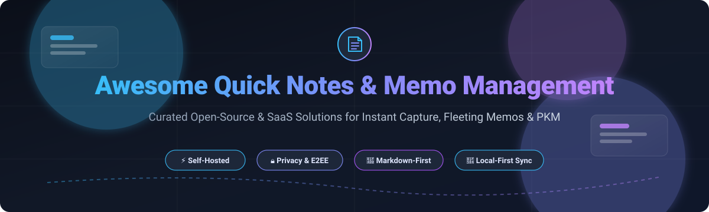

  

# 📝 Awesome Quick Notes & Memo Management

  
  
  
  
  
  

> 💡 **A curated list of top Quick Notes and Memo Management platforms** — comprehensive SaaS/commercial hosted solutions and self-hosted, privacy-first open-source alternatives for capturing, organizing, and retrieving short-form notes, fleeting memos, and to-dos.
>
> 🌟 **Star this repository if you find it helpful!** 🌟

---

## 📋 Table of Contents

- [🌐 Sector Overview & Market Dynamics](#-sector-overview--market-dynamics)
- [🟦 SaaS / Hosted Platforms](#-saas--hosted-platforms)
- [🟩 Open-Source Software](#-open-source-software)
  - [1. 🚀 AppFlowy](#1--appflowy)
  - [2. 🎨 AFFiNE](#2--affine)
  - [3. 📌 Memos](#3--memos)
  - [4. 📓 Joplin](#4--joplin)
  - [5. 🧠 Logseq](#5--logseq)
  - [6. 🌳 Trilium Notes](#6--trilium-notes)
  - [7. 🧪 Foam](#7--foam)
  - [8. 🛡️ Notesnook](#8-️-notesnook)
  - [9. 🔐 Standard Notes](#9--standard-notes)
  - [10. ⚡ SilverBullet](#10--silverbullet)
  - [11. 📂 QOwnNotes](#11--qownnotes)
  - [12. 📄 flatnotes](#12--flatnotes)
  - [13. 🌿 TriliumNext Notes](#13--triliumnext-notes)
  - [14. 🧭 Poznote](#14--poznote)
  - [15. 🪟 Glass Keep](#15--glass-keep)
  - [16. 🕊️ Minoo](#16-️-minoo)
- [📊 Comparison at a Glance](#-comparison-at-a-glance)
- [🤝 Contributing](#-contributing)
- [💖 Support](#-support)
- [📈 Star History](#-star-history)
- [📄 License](#-license)

---

## 🌐 Sector Overview & Market Dynamics

The global note-taking and knowledge management software market is valued at approximately **$2.5 billion** and projected to reach **$4.9+ billion by 2030** (expanding at a CAGR of ~12.8% to 15%). The sector exhibits a **hybrid, bifurcated structure**: it is **concentrated at the top**—where ecosystem giants (Apple, Microsoft, Google) capture massive baseline user volume by embedding default note apps into their operating systems—yet **highly fragmented across the independent software and open-source landscape**, where specialized tools compete intensely on local-first privacy, Markdown interoperability, bi-directional linking, end-to-end encryption (E2EE), and AI-assisted workflows.

---

## 🟦 SaaS / Hosted Platforms

Commercial, cloud-hosted quick notes and memo management services sorted by parent company scale (valuation / market capitalization descending).

| Product | Parent Company / Vendor | Company Valuation / Market Cap | Pricing (Starting Paid Tier) | Free Tier Limit | Highlights & Best For |
|---|---|---|---|---|---|
| **🍎 Apple Notes** | Apple Inc. (NASDAQ: AAPL) | ~$5.2 Trillion Market Cap | **$0.99/month** (iCloud+ 50 GB storage tier) | **5 GB total iCloud storage** across all Apple services; unlimited text notes, checklists, scanning, and sketches within storage limit. | 📱 Seamless Apple ecosystem integration, instantaneous Siri and Control Center quick capture, native lock-screen memos. |
| **🪟 Microsoft Sticky Notes** | Microsoft Corp. (NASDAQ: MSFT) | ~$3.9 Trillion Market Cap | **$6.99/month** or **$69.99/year** (Microsoft 365 Personal starting tier) | **5 GB free cloud storage** (Microsoft account); unlimited sticky notes and desktop memos synced via OneNote cloud. | 🖥️ Instant desktop sticky notes on Windows, OneNote mobile integration, pen-and-ink support. |
| **🔍 Google Keep** | Alphabet Inc. (NASDAQ: GOOGL) | ~$3.6 Trillion Market Cap | **$1.99/month** or **$19.99/year** (Google One 100 GB basic tier) | **15 GB free storage** (shared across Google Drive, Gmail, Google Photos); unlimited color-coded notes, checkboxes, audio memos, and image capture. | 🌈 Color-coded card view, instant search, location/time-based reminders, Google Workspace integration. |
| **🐘 Evernote** | Bending Spoons S.p.A. | ~$18.4 Billion Valuation | **$14.99/month** or **$99.00/year** (Evernote Starter plan) | **Strict 50 notes maximum, 1 notebook, 1 active connected device**, 1 GB monthly upload limit, and 200 MB maximum note size. | ✂️ Power web clipping, full-text document search, PDF indexing, and long-standing notebook organizational hierarchy. |
| **📝 Simplenote** | Automattic Inc. | ~$7.5 Billion Valuation | **$0.00** (Entirely free service subsidized by Automattic; paid Automattic plans apply to WordPress/WooCommerce) | **Unlimited notes, unlimited device sync, and full version history** across all platforms without expiration. Client apps are open source. | 🕊️ Distraction-free minimalist Markdown memo writing, instant cross-platform background sync, shareable web note URLs. |

---

## 🟩 Open-Source Software

Self-hosted, community-driven Quick Notes and Memo Management tools. Sorted by GitHub Stars_Count (descending).

### 1. 🚀 AppFlowy

* **Repository:** [AppFlowy-IO/AppFlowy](https://github.com/AppFlowy-IO/AppFlowy)
* **Stack:** Flutter / Rust / SQLite | **License:** AGPL-3.0
* **Overview:** Open-source, local-first alternative to Notion and quick notes workspaces. Built with Rust and Flutter for fast native performance across desktop and mobile.
* **Key Features:** Fast note taking, Kanban boards, database grid views, nested pages, end-to-end local data privacy, and self-hosted cloud sync options.
* **Best for:** Users who want a responsive, customizable local-first workspace for notes, to-dos, and project boards.

---

### 2. 🎨 AFFiNE

* **Repository:** [toeverything/AFFiNE](https://github.com/toeverything/AFFiNE)
* **Stack:** TypeScript / Rust / React | **License:** MIT
* **Overview:** Next-generation all-in-one knowledge base and visual memo canvas that merges structured text notes with infinite whiteboard ideation.
* **Key Features:** Dual-mode page and whiteboard views, real-time collaboration, block-based quick memo capture, complete offline-first architecture, and Docker self-hosting.
* **Best for:** Visual thinkers and team members wanting to blend quick memos with diagrams and mind maps in one unified document.

---

### 3. 📌 Memos

* **Repository:** [usememos/memos](https://github.com/usememos/memos)
* **Stack:** Go / React / SQLite / Docker | **License:** MIT
* **Overview:** The premier self-hosted, privacy-first alternative to Google Keep and micro-blogging memo scratchpads.
* **Key Features:** Instant floating capture window, Markdown formatting, `#tag` filtering, daily contribution heatmaps, REST/gRPC API, single Docker command deployment, and multi-user support.
* **Best for:** Anyone seeking an instant, clean, self-hosted Google Keep alternative with pure Markdown storage and zero vendor lock-in.

---

### 4. 📓 Joplin

* **Repository:** [laurent22/joplin](https://github.com/laurent22/joplin)
* **Stack:** TypeScript / React Native / SQLite | **License:** AGPL-3.0
* **Overview:** Battle-tested, award-winning open-source note-taking application designed as a complete, encrypted replacement for Evernote.
* **Key Features:** End-to-end encryption (E2EE), Markdown + Rich Text editor, web clipper extension, plugin ecosystem, geolocation tags, and sync via Nextcloud, WebDAV, Dropbox, or Joplin Cloud.
* **Best for:** Cross-platform users wanting high security, encrypted synchronization, and rich web-clipping capabilities.

---

### 5. 🧠 Logseq

* **Repository:** [logseq/logseq](https://github.com/logseq/logseq)
* **Stack:** ClojureScript / Electron | **License:** AGPL-3.0
* **Overview:** Privacy-first, open-source outliner and networked notebook built on top of plain-text Markdown and Org-mode files.
* **Key Features:** Daily journals for rapid memo capture, bi-directional linking (`[[wikilinks]]`), PDF annotations, flashcards, interactive graph view, and local file storage.
* **Best for:** Researchers, developers, and thinkers practicing Zettelkasten or daily journaling who need connected thought graphs.

---

### 6. 🌳 Trilium Notes

* **Repository:** [zadam/trilium](https://github.com/zadam/trilium)
* **Stack:** JavaScript / Node.js / SQLite | **License:** AGPL-3.0
* **Overview:** Deeply customizable hierarchical note-taking application designed for building large personal knowledge bases.
* **Key Features:** Arbitrarily deep tree structures, note cloning across multiple folders, script execution, automated note attributes, internal link diagrams, and self-hosted server synchronization.
* **Best for:** Power users with complex, interlinked knowledge hierarchies and technical documentation workflows.

---

### 7. 🧪 Foam

* **Repository:** [foambubble/foam](https://github.com/foambubble/foam)
* **Stack:** TypeScript / VS Code Extension | **License:** MIT
* **Overview:** A personal knowledge management and quick-notes workspace built entirely inside Visual Studio Code and Git.
* **Key Features:** Uses plain Markdown files, backlinking, graph visualization, autocomplete note linking, Git version control, and leverages the entire VS Code extension ecosystem.
* **Best for:** Software engineers and developers who want note-taking embedded seamlessly within their coding environment.

---

### 8. 🛡️ Notesnook

* **Repository:** [streetwriters/notesnook](https://github.com/streetwriters/notesnook)
* **Stack:** TypeScript / React / Rust | **License:** GPL-3.0
* **Overview:** Fully open-source, zero-knowledge end-to-end encrypted note-taking app built as a modern, private alternative to Evernote.
* **Key Features:** XChaCha20-Poly1305 encryption, generous free tier with unlimited devices, rich text notes, checklists, cross-platform mobile and desktop apps, and encrypted attachments.
* **Best for:** Privacy-conscious individuals seeking a polished, zero-setup encrypted notes app across all their devices.

---

### 9. 🔐 Standard Notes

* **Repository:** [standardnotes/app](https://github.com/standardnotes/app)
* **Stack:** TypeScript / React Native | **License:** AGPL-3.0
* **Overview:** Resilient, end-to-end encrypted notes app dedicated to long-term digital preservation and uncompromising confidentiality.
* **Key Features:** Zero-knowledge client-side encryption, unlimited device sync, plain text, offline access, self-hostable sync server, and automated backup routines.
* **Best for:** Users whose highest priorities are guaranteed encryption, clean aesthetics, and long-term data durability.

---

### 10. ⚡ SilverBullet

* **Repository:** [silverbulletmd/silverbullet](https://github.com/silverbulletmd/silverbullet)
* **Stack:** TypeScript / Deno | **License:** MIT
* **Overview:** An extensible, open-source personal knowledge management system written as a single binary web application that operates directly on plain Markdown files.
* **Key Features:** Live query language for dynamic note dashboards, keyboard-centric interface, PWA support with offline syncing, plug-in extensions, and lightweight resource usage.
* **Best for:** Minimalists and developers who want queryable, scriptable Markdown notes that run in any modern web browser.

---

### 11. 📂 QOwnNotes

* **Repository:** [pbek/QOwnNotes](https://github.com/pbek/QOwnNotes)
* **Stack:** C++ / Qt | **License:** GPL-2.0
* **Overview:** Open-source plain-text Markdown notepad with full Nextcloud / ownCloud integration.
* **Key Features:** Direct local `.md` file editing, synchronization via Nextcloud/ownCloud/Syncthing, task management, vim key mode, scriptable in QML/JavaScript, and encrypted notes support.
* **Best for:** Self-hosters who store their files on Nextcloud or Syncthing and want a fast desktop client.

---

### 12. 📄 flatnotes

* **Repository:** [dullage/flatnotes](https://github.com/dullage/flatnotes)
* **Stack:** Python / FastAPI / Vue.js | **License:** MIT
* **Overview:** A self-hosted, headless-compatible, distraction-free web note-taking app that directly reads and writes Markdown files from a directory without a database.
* **Key Features:** Raw file storage (no proprietary database), powerful full-text search engine, wikilinks support, responsive mobile-friendly UI, and one-container Docker deployment.
* **Best for:** Anyone who wants a zero-overhead web interface for a folder of flat Markdown notes.

---

### 13. 🌿 TriliumNext Notes

* **Repository:** [TriliumNext/Notes](https://github.com/TriliumNext/Notes)
* **Stack:** TypeScript / Node.js / SQLite / Docker | **License:** AGPL-3.0
* **Overview:** The active community-led continuation of Trilium Notes, committed to modernizing dependencies and expanding features.
* **Key Features:** Hierarchical note tree, Excalidraw integration, note cloning, automated attributes, SQLite backend, and native Evernote ENEX import.
* **Best for:** Teams and power users seeking the active, community-maintained future of the Trilium ecosystem.

---

### 14. 🧭 Poznote

* **Repository:** [timothepoznanski/poznote](https://github.com/timothepoznanski/poznote)
* **Stack:** PHP / SQLite / Docker | **License:** MIT
* **Overview:** Modern, self-hosted web workspace supporting six interchangeable note-taking and management modes.
* **Key Features:** Kanban boards, task lists, calendar views, graph visualizer, Excalidraw sketches, Git synchronization (GitHub/Forgejo), and Model Context Protocol (MCP) server support.
* **Best for:** Users who want multi-modal memo capture combined with Kanban project management and AI assistant integration.

---

### 15. 🪟 Glass Keep

* **Repository:** [nikunjsingh93/react-glass-keep](https://github.com/nikunjsingh93/react-glass-keep)
* **Stack:** React / Express / SQLite / Docker | **License:** MIT
* **Overview:** A modern self-hosted Google Keep alternative wrapped in a glassmorphism aesthetic UI.
* **Key Features:** Quick note capture, draggable checklist items, color tags, Google Takeout import support, local AI assistant (RAG with Llama), and cross-platform desktop/PWA clients.
* **Best for:** Users who love the visual look of Google Keep cards but want self-hosted privacy and local AI querying.

---

### 16. 🕊️ Minoo

* **Repository:** [ScepticDope/Minoo](https://github.com/ScepticDope/Minoo)
* **Stack:** Tauri v2 / Rust / JavaScript | **License:** MIT
* **Overview:** Lightweight, minimalist cross-platform Markdown memo app with decentralized local-network synchronization.
* **Key Features:** Peer-to-peer local network sync without servers or cloud accounts, pure `.md` folder storage, command palette, themes, and instant startup time.
* **Best for:** Users who want zero-configuration local-area sync for Markdown memos without trusting third-party servers.

---

## 📊 Comparison at a Glance

| Tool | License | Primary Stack | Quick Capture | Markdown | Self-Hosted | Mobile App | Sync Architecture |
|---|---|---|:---:|:---:|:---:|:---:|---|
| **🍎 Apple Notes** | Proprietary | Apple Native | ✅ | ❌ | ❌ | ✅ | Apple iCloud |
| **🪟 Microsoft Sticky Notes** | Proprietary | Windows / C++ | ✅ | ❌ | ❌ | ✅ | Microsoft Exchange / OneNote |
| **🔍 Google Keep** | Proprietary | Cloud Web/Mobile | ✅ | ❌ | ❌ | ✅ | Google Cloud Sync |
| **🐘 Evernote** | Proprietary | Cloud Web/Desktop | ✅ | ❌ | ❌ | ✅ | Evernote Cloud |
| **📝 Simplenote** | Proprietary (Client Open) | Electron / React Native | ✅ | ✅ | ❌ | ✅ | Automattic Simperium Sync |
| **🚀 AppFlowy** | AGPL-3.0 | Flutter / Rust | ✅ | ✅ | ✅ | ✅ | Local-first / AppFlowy Cloud / Self-hosted |
| **🎨 AFFiNE** | MIT | TypeScript / Rust | ✅ | ✅ | ✅ | ✅ | Local-first / AFFiNE Cloud / Docker |
| **📌 Memos** | MIT | Go / React / SQLite | ✅ | ✅ | ✅ | ✅ (PWA/Community) | Self-hosted Docker / REST API |
| **📓 Joplin** | AGPL-3.0 | TypeScript / React Native | ✅ | ✅ | ✅ | ✅ | Nextcloud / WebDAV / Dropbox / Joplin Cloud |
| **🧠 Logseq** | AGPL-3.0 | ClojureScript / Electron | ✅ | ✅ | ✅ (Local-first) | ✅ | Local Git / Logseq Sync |
| **🌳 Trilium Notes** | AGPL-3.0 | Node.js / SQLite | ⚠️ | ✅ | ✅ | ❌ (Community) | Self-hosted Trilium Server |
| **🧪 Foam** | MIT | TypeScript / VS Code | ✅ | ✅ | ✅ (Local-first) | ❌ | Git / GitHub repository sync |
| **🛡️ Notesnook** | GPL-3.0 | TypeScript / React / Rust | ✅ | ✅ | ✅ | ✅ | End-to-End Encrypted Sync Server |
| **🔐 Standard Notes** | AGPL-3.0 | TypeScript / React Native | ✅ | ⚠️ (Paid) | ✅ | ✅ | E2EE Sync Server |
| **⚡ SilverBullet** | MIT | TypeScript / Deno | ✅ | ✅ | ✅ | ✅ (PWA) | Local file storage / WebDAV |
| **📂 QOwnNotes** | GPL-2.0 | C++ / Qt | ✅ | ✅ | ✅ | ✅ (via Nextcloud Notes) | Nextcloud / ownCloud / Syncthing |
| **📄 flatnotes** | MIT | Python / Vue.js | ✅ | ✅ | ✅ | ✅ (PWA) | Filesystem directory / Docker |
| **🌿 TriliumNext** | AGPL-3.0 | TypeScript / Node.js | ⚠️ | ✅ | ✅ | ❌ (Community) | Self-hosted Docker / Server sync |
| **🧭 Poznote** | MIT | PHP / SQLite | ✅ | ✅ | ✅ | ✅ (PWA) | Git sync / Self-hosted web server |
| **🪟 Glass Keep** | MIT | React / SQLite | ✅ | ✅ | ✅ | ✅ (PWA/Tauri) | Self-hosted Docker server |
| **🕊️ Minoo** | MIT | Tauri / Rust | ✅ | ✅ | ✅ (Local-first) | ✅ | Local network P2P sync |

---

## 🤝 Contributing

Contributions, additions, and suggestions are warmly encouraged! To propose a new open-source note-taking or memo management tool:

1. 🍴 Fork this repository.
2. 🔍 Verify that the project is actively maintained (commits or releases within the last 12 months) and open source.
3. 📝 Add the project to the list with its GitHub repository link, Stars_Badge, technology stack, license, and stand-out capabilities.
4. 🔢 Ensure the open-source list remains sorted by GitHub Stars_Count descending.
5. 🚀 Open a Pull Request with a clear description of why the tool is a great addition.

---

## 💖 Support

Thank you for exploring and using this curated guide to Quick Notes & Memo Management tools! 🙏

If you found this resource helpful, please consider supporting the project:
* ⭐ **Star** this repository on GitHub to help others discover it.
* 🍴 **Fork** and contribute new tools, updates, or fixes.
* 📢 **Share** this list with fellow developers, researchers, and productivity enthusiasts.
* ☕ **Buy a Coffee / Sponsor**: Support ongoing maintenance and curation on the [GitHub Sponsor Dashboard](https://github.com/sponsors/ishandutta2007).

---

## 📈 Star History

---

## 📄 License

This repository and curated list are released under the [Creative Commons Zero v1.0 Universal](LICENSE) (CC0 1.0) Public Domain Dedication. All listed software platforms, logos, and trademarks belong to their respective copyright holders.
